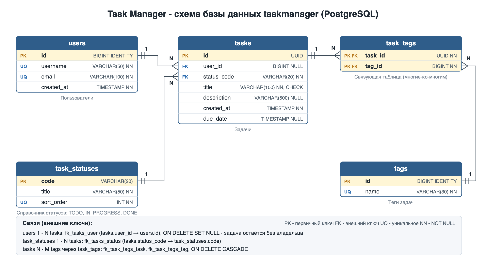

# КТ-3. База данных для веб-приложения Task Manager (Spring MVC)

Продолжение КТ-2 ([valer1q/taskmanager](https://github.com/valer1q/taskmanager)). В КТ-2 задачи хранились
в памяти (`ConcurrentHashMap`) и пропадали после перезапуска. В КТ-3 для приложения создана база данных
PostgreSQL, и все данные хранятся в ней.

## Что сдаётся

| Требование | Файл |
|---|---|
| SQL: создание базы данных и пользователя | [`database/01_create_database.sql`](database/01_create_database.sql) |
| SQL: создание таблиц, первичных и внешних ключей, индексов, справочника статусов | [`database/02_create_tables.sql`](database/02_create_tables.sql) |
| SQL: тестовые данные | [`database/03_insert_data.sql`](database/03_insert_data.sql) |
| SQL: примеры запросов с JOIN и просмотр всех ключей | [`database/04_queries.sql`](database/04_queries.sql) |
| Схема связей таблиц (картинка) | [`docs/er-diagram.png`](docs/er-diagram.png), исходник [`docs/er-diagram.svg`](docs/er-diagram.svg) |
| Веб-приложение, работающее с базой | `src/main/java/...` |



## Таблицы и связи

| Таблица | Назначение | Первичный ключ | Внешние ключи |
|---|---|---|---|
| `users` | пользователи - владельцы задач | `id` (BIGINT, автоинкремент) | - |
| `task_statuses` | справочник статусов `TODO`, `IN_PROGRESS`, `DONE` | `code` | - |
| `tasks` | задачи (поля из КТ-2 + владелец) | `id` (UUID) | `user_id → users.id` (ON DELETE SET NULL), `status_code → task_statuses.code` |
| `tags` | теги задач | `id` (BIGINT, автоинкремент) | - |
| `task_tags` | связь задач и тегов | `(task_id, tag_id)` - составной | `task_id → tasks.id`, `tag_id → tags.id` (ON DELETE CASCADE) |

Типы связей:
- **один-ко-многим:** `users` → `tasks`, `task_statuses` → `tasks`;
- **многие-ко-многим:** `tasks` ↔ `tags` через таблицу `task_tags`.

Кроме ключей: уникальные ограничения (`username`, `email`, `tags.name`), `NOT NULL`, `CHECK` на длину названия задачи,
индексы на внешние ключи и `due_date`.

## Создание базы данных

### Вариант 1 - свой PostgreSQL (через psql)
```bash
psql -U postgres -f database/01_create_database.sql
psql -U taskmanager_user -d taskmanager -f database/02_create_tables.sql
psql -U taskmanager_user -d taskmanager -f database/03_insert_data.sql
```
Пароль пользователя `taskmanager_user` - `taskmanager_pass` (задаётся в `01_create_database.sql`).
Скрипт `02_create_tables.sql` можно запускать повторно - он сначала удаляет старые таблицы.

### Вариант 2 - Docker
```bash
docker compose up -d
```
Docker сам создаёт базу `taskmanager` и пользователя (это то же, что делает `01_create_database.sql`)
и при первом запуске выполняет `02_create_tables.sql` и `03_insert_data.sql`.
Чтобы пересоздать базу с нуля: `docker compose down -v`, затем снова `docker compose up -d`.

## Запуск приложения
```bash
./gradlew bootRun
```
Сервер: `http://localhost:8080`. Настройки подключения - в `src/main/resources/application.properties`.

Интерфейс из КТ-2 работает без изменений:
```bash
cd taskmanager-ui
npm install
npm run dev
```

Тесты (используют H2 в режиме PostgreSQL и создают схему тем же скриптом `02_create_tables.sql`, отдельная база не нужна):
```bash
./gradlew test
```

## Эндпоинты

| Метод | Путь | Описание |
|---|---|---|
| GET | `/tasks` | все задачи |
| GET | `/tasks/{id}` | задача по id |
| POST | `/tasks` | создать задачу |
| PUT | `/tasks/{id}` | изменить задачу |
| DELETE | `/tasks/{id}` | удалить задачу (её связи с тегами удаляются каскадно) |
| GET | `/users` | все пользователи |
| GET | `/users/{id}` | пользователь по id |
| GET | `/users/{id}/tasks` | задачи пользователя |
| POST | `/users` | создать пользователя |
| DELETE | `/users/{id}` | удалить пользователя (его задачи остаются, `user_id` становится `NULL`) |
| GET | `/statuses` | справочник статусов из таблицы `task_statuses` |

Пример создания задачи с владельцем и тегами:
```bash
curl -X POST http://localhost:8080/tasks \
  -H "Content-Type: application/json" \
  -d '{"title":"Нарисовать ER-диаграмму","status":"IN_PROGRESS","userId":1,"tags":["учёба","диаграммы"]}'
```

Поля `userId` и `tags` необязательные, поэтому запросы в формате КТ-2 (и интерфейс из КТ-2) работают как раньше.
Если при `PUT` эти поля не переданы, владелец и теги задачи сохраняются.

## Что изменилось в коде по сравнению с КТ-2
- Добавлены зависимости `spring-boot-starter-jdbc` и драйвер PostgreSQL.
- `TaskService` больше не хранит задачи в `ConcurrentHashMap` - работает через `TaskRepository` (SQL-запросы через `JdbcTemplate`).
- Новые классы для пользователей и справочника статусов: `User`, `UserRequest`, `UserRepository`, `UserService`, `UserController`, `TaskStatusRepository`, `TaskStatusController`.
- Обработчик ошибок дополнен: 404 для пользователя, 409 при повторном username/email, 400 для некорректного JSON и id.
