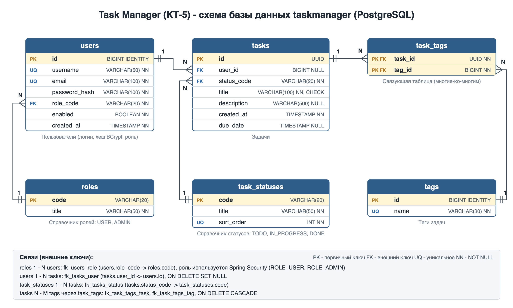

# КТ-5. Task Manager на Spring Boot + Spring Security

Приложение из КТ-2/КТ-3, переписанное с использованием Spring Boot и Spring Security:
- базовая аутентификация (HTTP Basic);
- пользователи хранятся в таблице `users` базы PostgreSQL, пароли - в виде хеша BCrypt;
- роли `USER` и `ADMIN` хранятся в таблице `roles`.



## Запуск

1. База данных (Docker):
```bash
docker compose up -d
```
Без Docker - выполнить скрипты из папки `database` по порядку (`01` от имени postgres, `02` и `03` от имени `taskmanager_user`).

2. Сервер:
```bash
./gradlew bootRun
```

3. Интерфейс (по желанию):
```bash
cd taskmanager-ui
npm install
npm run dev
```
Открыть http://localhost:5173 и войти.

Тесты (база не нужна, используется H2):
```bash
./gradlew test
```

## Тестовые пользователи

| Логин | Пароль | Роль |
|---|---|---|
| admin | admin123 | ADMIN |
| alex | alex123 | USER |
| maria | maria123 | USER |
| ivan | ivan123 | USER |

## Права доступа

| Запрос | Доступ |
|---|---|
| `POST /auth/register` | все (регистрация, роль USER) |
| `GET /statuses` | все |
| `GET /auth/me` | любой вошедший пользователь |
| `/tasks/**` | любой вошедший: USER видит и меняет только свои задачи, ADMIN - все |
| `/users/**` | только ADMIN |

Ответы: без логина или с неверным паролем - 401, нет прав - 403.

## Примеры

```bash
curl -u alex:alex123 http://localhost:8080/tasks
```

```bash
curl -X POST http://localhost:8080/auth/register -H "Content-Type: application/json" -d '{"username":"petr","email":"petr@mail.ru","password":"petr12345"}'
```

```bash
curl -u admin:admin123 http://localhost:8080/users
```

## Что сделано

- `SecurityConfig` - правила доступа, HTTP Basic, BCrypt, CORS для интерфейса, без сессий (STATELESS).
- `DatabaseUserDetailsService` - Spring Security загружает пользователя из таблицы `users`.
- `AppUserDetails` - текущий пользователь (id, роль), передаётся в контроллеры через `@AuthenticationPrincipal`.
- `JsonAuthenticationEntryPoint`, `JsonAccessDeniedHandler` - ошибки 401 и 403 в JSON.
- `AuthController` - регистрация и `/auth/me`.
- В БД добавлены таблица `roles` и столбцы `password_hash`, `role_code`, `enabled` в `users`.
- В интерфейс добавлены вход, регистрация и выход.
